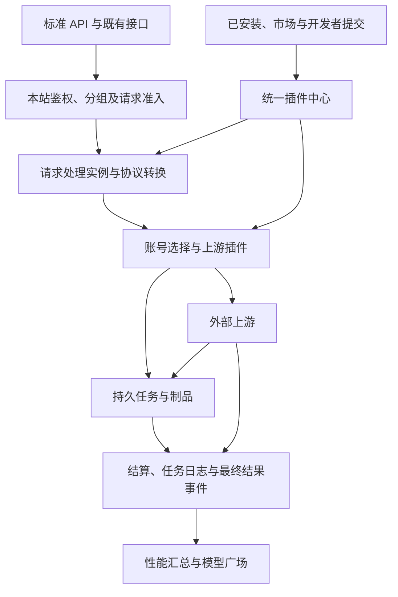

# 插件中心、任务日志与模型广场重构方案

> **最新架构**：[独立 New API 插件与任务引擎](NEWAPI_ENGINE_DECOUPLING.md)（2026-11-22）。按用户最新补充，旧 Sub 原生插件单独保留，不再统一两种运行时。[上一版 50 项任务](PLUGIN_SYSTEM_MIGRATION_PLAN.md)按新方案第 7 节修订。本文件保留早期调研与增量证据，不能把历史差异表作为当前待办。

状态：分阶段实施中；已完成分组模型、独立任务日志、统一插件中心与本站市场，已接入 JSON ingress、Task JSON egress 和 Provider 基础转发，尚未发布部署

调研日期：2026-11-21

## 1. 结论与目标

建议沿用 New API 的插件契约与管理流程，在 Sub2API 内建立统一插件中心，接入现有账号、分组、调度、权限和账本。前端继续使用 Vue，后端继续使用当前项目的 Go、Gin、Repository 与 PostgreSQL 结构。

可以把它理解成：插件负责把不同厂商的话翻译成本站能理解的话；本站负责决定谁能调用、用哪个账号、收多少钱，以及保存任务和日志。

本次完整目标包含：

1. 插件中心提供已安装、插件市场、版本管理和开发者提交入口。
2. 兼容 New API 的任务、Provider、请求处理三类能力，统一管理现有原生扩展。
3. 上游连接继续在“账号”里添加，选择插件、模型和连接配置。
4. 视频、图片等异步任务有独立“任务日志”，保留现有计费对账能力。
5. 模型广场只展示当前分组配置支持的模型，价格与性能也按同一分组计算。
6. 卡片展示真实的成功率、状态条、延迟和吞吐；任务状态与性能数据持续更新。

“完整兼容”的验收依据是固定版本的能力矩阵及真实调用链路。New API 仓库里的全部静态渠道适配器，还需要分别评估是否迁成插件；它们不会随着 JavaScript 运行时一并自动获得。

## 2. 对照基线与当前差异

### 2.1 固定版本

| 对象 | 本次核实版本 | 用途 |
| --- | --- | --- |
| 当前 Sub2API | `f440d7591e`，v0.2.26 对应功能提交 | 迁移起点 |
| 当前已引入的 New API 运行时 | `48f9df96ea7c68eae04a0f3687869f232f48929f` | 既有兼容基线 |
| 本地 New API main | `8542c9d649` | 参考较新的插件契约、界面及分组修复 |
| 线上 New API | `v1.0.0-rc.51` | 页面体验参考 |

本地 main 与线上版本存在差异。实施第一步应锁定目标提交、同步 schema/types/内置脚本，并生成兼容清单；后续升级按版本进行。不得用“跟随 main”代替可验证的兼容承诺。

已引入的 New API 代码使用 AGPL，沿用 `backend/internal/newapi/NOTICE.md` 和 `docs/customization/THIRD_PARTY.md` 的来源记录。继续移植代码时保留适用的 LICENSE、NOTICE、修改说明和对应源码；复用其界面代码时同步落实上游 NOTICE 要求的可见归属与项目链接。

### 2.2 迁移起点的差异（历史记录，非当前待办）

| 功能 | 当前 Sub2API | 本次目标 |
| --- | --- | --- |
| 插件管理 | 原生 `.s2plugin` 页面内插入 JS 插件面板 | 统一目录、详情、分类、版本及状态 |
| 内置插件 | 下拉选择后手工安装 | 随系统登记 factory，直接显示内置版本 |
| JS 任务 | 已有持久化视频任务主链路 | 补齐协议、制品、用量与更多任务类型 |
| Provider | 能识别脚本声明，缺通用宿主接点 | 接入转换、签名、凭据、流、余额和维护钩子 |
| 请求处理 | 能识别声明，缺实例与阶段调度 | 全局、分组、账号实例及试运行、执行记录 |
| 任务日志 | 插件页只列待对账异常任务 | 独立菜单、全状态、用户和管理员视图 |
| 插件市场 | 尚无完整市场 | 系统源、社区源、安装升级、本站投稿发布 |
| 模型范围 | 普通模型由定价渠道扩展，约束不一致 | 按账号支持、分组许可与访问权限统一生成 |
| 性能 | 24h 明细聚合，卡片展示有限 | 正确采样、分组聚合、真实状态条、持续更新 |

页面核实中，本站模型广场返回了 182 个模型；当前普通模型清单生成没有统一应用分组模型白名单。卡片性能请求也没有携带当前选中分组。两处需要一起修正。

## 3. 总体结构与职责



图中是职责关系；请求各阶段的准确执行顺序，按第 5 节契约实施。

### 3.1 统一管理层，保留两种运行时

- JavaScript 运行时执行 New API 兼容的任务、Provider、请求处理插件。
- 现有原生进程/gRPC 运行时继续承担 `.s2plugin` 扩展，例如 OpenAI OAuth 出站传输。
- 两者共用目录展示、来源、版本、安装、启停、审计与兼容性信息；内部仍按各自契约执行。
- 第一阶段不要求所有原生插件重写为 JS，也不把原生传输接口伪装成具备全部 Provider 能力。
- 在本项目现有分层内完成，不为市场额外引入独立服务、消息中间件或第二套账号系统。

### 3.2 账号、渠道与插件的对应

New API 的 Channel 主要代表上游连接；本项目 Account 承担连接和凭据，本项目 Channel 还有模型映射、定价和分组职责。

因此新增上游的操作仍为：

`账号 → 新建上游连接 → 选择插件 → 填 URL/凭据 → 选择启用模型 → 绑定分组 → 测试`

账号保存插件绑定、激活版本策略及配置。模型允许范围来自账号实际配置，插件声明的模型列表作为可选范围。现有渠道定价和分组倍率继续参与报价与结算。

## 4. 插件中心设计

### 4.1 页面结构

保留 `/admin/plugins`，改为以下视图：

- **已安装**：搜索、任务/上游适配/请求处理/原生扩展分类、卡片和表格切换。
- **插件市场**：系统、社区、可配置兼容来源；按名称、作者、能力和模型搜索。
- **开发者提交**：管理员审核入口；普通用户在自己的开发者页面提交和查看进度。

每个插件显示名称、图标、key、作者、来源、当前版本、内置版本、升级状态、声明能力、可执行能力、模型和启停状态。详情单独提供说明、配置、版本、变更记录、绑定账号、兼容性和诊断信息。

插件安装后不自动绑定生产账号。内置插件随系统登记，不要求管理员逐个从下拉框安装。

### 4.2 身份和版本

- 分开记录 `runtime`、`kind` 与 `source`：JS/原生是运行时，任务/Provider/请求处理是能力，系统/社区/上传是来源。
- 同一插件可以声明多种能力，分类计数允许重叠。
- 插件版本不可变，保留当前同 key、同 version、不同 hash 拒绝的规则。
- 社区插件采用发布者命名空间，不能用同 key 冒充系统内置插件。
- 对系统插件提供明确的升级覆盖、版本比较、回滚和“恢复内置版”；只有授权的覆盖操作可占用受保护 key。
- 只有声明和宿主实际实现都满足时才显示“可用”。缺少必需能力时禁止激活，给出具体原因。
- `new-api` 专属工具函数需要明确适配或标记不支持，不能静默忽略后宣称兼容。

### 4.3 启停与升级

- 菜单可见性、单插件启用、任务/Provider 总开关、请求处理实例启用分别管理。
- New API 的请求处理实例有独立运行语义，不应被任务/Provider 总开关意外关闭。
- 新请求使用激活版本；在途任务锁定原插件版本、连接、模型、配置与价格快照。
- 普通停用阻止新任务，允许已创建任务继续查询和结算。紧急停止与凭据撤销另设明确动作。
- 被在途任务引用的版本保留，卸载先检查引用，不能直接删除造成任务失联。
- 保留既有敏感操作 step-up 和操作审计。

## 5. 完成宿主能力，而不止加载脚本

### 5.1 能力交付矩阵

| 能力域 | 需要实际接通的内容 | 验收重点 |
| --- | --- | --- |
| 任务 | 提交、查询、同步完成、提交流、终态、用量、制品、内容下载 | 创建到交付和结算完整闭环 |
| 标准协议 | 插件声明的 host protocols、JSON/multipart、文件引用及输出转换 | 同一任务用标准 API 创建和查询 |
| 原生入口 | native routes、路由注册、鉴权、冲突检查 | 不覆盖宿主保留路由、不越过分组权限 |
| Provider relay | `convertRequest`、`prepareRequest`、签名、响应与流转换 | 正常、错误、取消及断流语义一致 |
| Provider 凭据 | key exchange/check、login、refresh、revoke、credential rejection | 接入现有凭据存储和账号状态 |
| Provider 维护 | 余额查询、scheduled、维护状态 | 多实例下可控执行、错误不泄露凭据 |
| 请求处理 | 实例、scope、model match、各阶段、reply、report | 顺序、重试、失败处理、脱敏一致 |
| 价格契约 | usage schema/profile、估算和实际用量、表达式单位 | 展示、预扣和结算使用相同价格语义 |
| 宿主工具 | fetch、媒体、签名、配置校验与专属工具 | 权限、限额及能力声明一致 |

逐项记录“已实现 / 部分实现 / 不支持”及测试证据。语法可编译只证明运行时可以读取插件，不能代替表中的链路验证。

### 5.2 请求处理

新增 `/admin/request-processing`。实例包含插件、固定版本、名称、配置、启用、作用域、模型匹配与排序；账号可以按顺序绑定实例。

同阶段遵循 New API 的全局实例 → 分组实例 → 上游连接实例顺序。New API 的连接实例映射为本项目账号实例，当前定价渠道的现有规则另外对照，避免重复运行。

需要准确保留阶段差异：

- `ingress` 每个请求一次，在解析和报价前运行；变更后的请求供后续使用。
- `request` 每次账号尝试执行，在映射后、转换前运行。
- `outbound`、参数覆盖、`egress` 按所选基线的协议规则排序；`egress` 是指定转换边界上的只读观察，不应笼统当作任意插件最终发出的网络字节。
- `reply` 和 `report` 分别按契约执行；任务、音频、multipart、Realtime 等有不同覆盖范围，不把所有路由强行套同一套阶段。
- 每个实例每个阶段只运行一次；请求开始后固定实例及版本，重试不受后台临时编辑影响。
- 与现有提示词审核、参数覆盖、脱敏等能力明确执行顺序，避免同一效果执行两遍。
- 试运行支持未保存配置、示例输入、阶段结果和脱敏后的差异预览，不产生生产账单。

### 5.3 视频协议与既有接口

既有 OpenAI Videos、`/videos/generations`、Seedance 等路径可以逐步由内置适配器接入同一任务核心。标准接口的对外 DTO、鉴权、账本和下载授权仍由宿主管理；插件完成上游协议差异、状态转换和用量提取。

迁移顺序：先统一日志投影，再接统一任务驱动，最后逐路由切换执行。保留旧 URL、任务 ID 和响应格式的兼容入口；任务持久层去掉仅允许 `video_` 类型的硬编码时，需要同时迁移外键和校验。不得在切换中重新提交已有任务。

新原生入口必须预检保留命名空间和冲突；一个插件不能抢占另一个插件或宿主的标准路由。

## 6. 独立“任务日志”

### 6.1 入口和列表

- 管理端新增 `/admin/task-logs`，查看全部任务、自己的任务、待处理任务。
- 用户端新增 `/task-logs`，只查看本人任务。
- 原插件页“视频任务待对账”迁入任务日志的待处理视图。
- 使用日志继续承担请求和扣费查询；任务日志负责排队到完成的任务生命周期，两者通过关联 ID 跳转。

列表字段：提交时间、用户、分组、模型、上游账号（管理端）、插件与版本、任务 ID、类型/动作、状态、真实进度、已耗时/完成耗时、交付状态、计费状态、制品及详情。

筛选：时间、任务 ID、模型、分组、账号、插件、类型、状态、结算状态。服务端分页；不能只返回最早 100 条异常任务。

### 6.2 详情与操作

详情提供状态时间线、各阶段时间、公开参数、脱敏错误、制品、冻结/结算金额、用量和关联使用日志。

管理员可查看允许公开的上游请求信息及执行诊断。插件私有 state、密钥、完整敏感请求不进入用户 DTO；上游 ID、内部账号信息按角色裁剪。

保留当前恢复、退款、结算操作的 step-up、原因和审计。提交结果不确定时优先查询和对账，不把“重试提交”当作普通恢复。任何人工动作都需要幂等键与状态校验。

### 6.3 数据迁移

复用 `sub2api_generation_tasks` 和 `sub2api_generation_events`：它们已有归属、版本锁定、价格快照、租约、状态和事件基础。

先增加统一查询投影及必要索引，避免为菜单再复制一套会漂移的任务事实表。旧执行链路可通过来源标识和原始 ID 映射进入统一查询；不适用的新字段允许为空。

当前旧图片任务主要在 Redis，TTL 为 24 小时。切换后新增任务写持久历史；迁移时只导入仍可读取的旧记录，并用来源 ID 去重。已经过期的历史无法补回，界面应说明历史覆盖起点。

任务执行、制品交付与计费状态继续分开，例如“生成成功、下载失败”和“生成成功、待对账”都需要准确显示。

## 7. 插件市场与用户开发上传

### 7.1 来源

市场包括本站系统源、本站社区源，可选接入 New API 官方和社区兼容索引。来源配置与插件运行时、能力分类分开。

已核实 New API 网关消费 `newapi.ai` 等外部市场索引。本站用户投稿、审核、发布、撤回、开发者管理需要在本项目实现，不能只复制市场列表就视作完成。

首次实现采用当前后端加元数据表和现有持久文件/对象存储，不要求单独部署市场服务。

### 7.2 发布流程

`创建草稿 → 上传版本与文档 → 受限校验 → 预览/试运行 → 提交审核 → 管理员审核 → 发布 → 可选撤回`

- 普通用户可以开发、上传、维护自己的 JS 插件；上传进入草稿，不会立即在生产账号执行。
- 每个发布版本记录源码/包 hash、作者、许可证、README、changelog、兼容版本、必需能力、权限和审查结果。
- 发布版本不可替换；修改内容需要新版本。撤回禁止新安装，不能自动破坏已经锁定的任务。
- 安装固定源码和 hash；更新索引后重新校验，来源声明不能自行获得“系统官方”身份。
- 原生包可进入目录，但安装和运行继续按可信签名与管理员策略执行。当前子进程边界不是操作系统沙箱，不向普通用户开放上传原生代码后直接运行。
- 网络访问由宿主管控，落实已有请求大小、超时、媒体限额和连接策略，避免插件绕过账号代理与凭据隔离。
- 插件文档渲染需过滤主动内容；沿用现有受限 iframe 和 UI Bridge 边界。

### 7.3 开发者工具

提供任务、Provider、请求处理三个最小模板，以及当前 API 的 types/schema、配置表单预览、假上游 fixture、安装包校验和本地调试说明。

开发者页面显示我的插件、草稿、已发布版本、审核意见、兼容结果和安装统计。平台提供 SDK 和文档，不要求开发者修改宿主 Go/Vue 代码才能增加一个标准 JS 上游插件。

## 8. 价格、加价与账本

保留当前美元金额和 decimal 账本，通过适配层读取 New API 的用量与价格声明。New API 的整数 quota 单位不能直接代入本站金额字段。

支持按次、张、视频秒数、token、credit 及条件档位；用量字段名、字段说明、单位遵循所选 New API 契约。需要兼容表达式时同步其输入、返回值及边界规则，不能只照搬价格表单。

建议提供三种明确报价方式：

1. 手工固定售价或阶梯价。
2. 已配置上游成本 × 加价系数 + 固定费用。
3. 上游可信成本回报 + 预先约定的加价规则，并配置可预扣的报价或金额上限。

“上游有价格”需要区分文档参考价、管理员配置成本、实际扣费回报。只有约定来源和单位的可信数据可用于自动成本结算；未返回成本时按配置规则处理，不能默认为零。

显示价格、提交前估算、冻结、终态结算共用同一价格解析和快照，保留分组倍率及既有优先级。任务创建后的价格变更不改变其账单。

视频秒数、token 每百万单价和表达式返回的单次 USD 分别处理，防止百万倍单位偏差。超出已冻结金额的差额按现有资金规则处理，不静默多扣；缺少实际用量时进入既有对账流程。

## 9. 模型广场只展示当前分组支持的模型

### 9.1 统一支持范围

```text
可展示范围 = 用户可见分组
           ∩ 当前选中分组
           ∩ 分组内已配置可用上游的模型与协议能力
           ∩ 分组模型许可
```

价格表用于给这些模型补价，不扩展支持集合。插件列出 50 个模型、账号只启用 3 个时，账号贡献的支持范围是这 3 个。

新增共享的模型支持策略解析层，供 `/v1/models`、模型广场、详情、性能 scope 和实际路由候选校验复用。它读取配置与能力事实，不通过占用并发配额的真实调度来枚举模型。

需要处理模型别名、映射、通配规则和复合平台；通配只基于明确目录或配置展开。暂时限流、熔断显示为暂不可用，不让模型在页面频繁消失。

### 9.2 前后端联动

- 分组默认选择 URL 中有效的 `group_id`，其次为用户上次有效选择，再按现有分组排序选首个有模型的可见分组。
- “所有分组”作为可选入口，只展示当前用户可见组的并集。
- 切分组同步刷新模型、数量、标签、价格和性能。
- 沿用当前 `/model-plaza/models/:modelId` 独立详情页，保留 `group_id`、筛选上下文和 `embedded`。
- 同名不同平台/协议的模型按稳定目录 ID 区分，不能误合并价格和指标。
- 现有清单、模型详情、性能汇总、性能详情接口统一接收并验证 `group_id`；服务端验证分组权限，缓存按权限范围和配置版本隔离。
- 匿名访问继续遵循当前广场公开开关与公共分组策略；不能借性能接口查询私有组。

## 10. 状态条、延迟、吞吐与持续更新

### 10.1 展示定义

| 模型类型 | 卡片主要展示 | 详情补充 |
| --- | --- | --- |
| 文本/推理 | 近 24h 成功率、真实状态条、平均完成延迟、生成 token/s | 首 token、P95、样本数和曲线 |
| 图片 | 任务成功率、平均完成耗时、进行中数量 | 完成任务速率、失败原因和阶段耗时 |
| 视频/音频任务 | 任务成功率、平均完成耗时、进行中数量 | 排队/提交/生成/交付耗时与任务速率 |

只有获得真实且口径明确的 token 用量及生成区间时，才展示媒体模型 token/s。未提供时显示“—”或任务速率，不能把视频秒数或张数冒充 token。

文本“延迟”默认表示成功请求端到端完成耗时，并在提示中说明；首 token 耗时另列。截图里的性能区可以实现，但每个数字都应有时间窗口和有效样本数。

### 10.2 采样规则

- 以宿主最终请求结果为事实，一次请求重试多个账号只计一次；尝试级错误留在运维日志中。
- 零费用成功请求也计入成功率，修复当前 `actual_cost > 0` 带来的漏计。
- HTTP 200 中的 SSE 错误、异常断流、不完整终结需要按实际结果判定。
- 参数错误、用户余额不足等业务拒绝与用户主动取消通常不计为模型故障；上游凭据失效、上游限流/余额和服务故障按能力可用性规则判定失败。
- 异步任务只在最终生成/交付结果确定后计终态，提交返回 200 不能计为生成成功。保留生成成功与交付失败的分项原因。
- 任务终态 CAS 成功后发出唯一结果事件；不能再从 usage log 重复采一遍同一任务。
- 流式吞吐为有效样本的输出 token 总数 ÷ 生成阶段总秒数，生成阶段扣除首 token 等待，不对每个请求的 TPS 做简单平均。
- 状态条采用最近 24h 的 24 个小时桶。绿/黄/红表示有样本桶的不同成功率区间，灰色表示无样本；阈值明确展示，不填造数据。
- 当前分组的卡片、详情和性能必须使用同一 scope，禁止混入其他分组数据。

### 10.3 存储与推送

在请求/任务最终结果处持久记录去重事件，再聚合为时间桶；沿用 PostgreSQL 与可选 Redis。状态变更和任务事件原子提交；汇总消费的游标与桶增量同事务更新，确保多实例和重启后不会重复计算。

Redis 作为可重建热缓存，不作为唯一历史。查询读取时间桶与最近增量，避免每次前端刷新扫描一天明细。P95 使用可合并的直方图/分布，或详情受限明细查询，不平均各小时的 P95。

推荐更新节奏是设计目标：

- 任务变化通过 SSE 推送，聚合/节流后在约 2–5 秒内显示；上游查询间隔遵守厂商限制。
- 模型性能完成汇总后推送失效通知，客户端批量刷新当前可见模型，目标约 5–10 秒。
- 无推送时任务按 3–5 秒、模型按约 15 秒轮询降级；无活动任务时放慢。
- 先取得快照，再订阅并补齐游标后的事件，解决快照与订阅之间的竞态。
- 使用现有认证方式；需要鉴权头时使用 fetch 流读取 SSE，认证 token 不放 URL。
- 页面隐藏暂停刷新，断线重连补快照。普通用户只能订阅自己有权查看的任务和分组。

“实时”取决于上游何时返回状态。没有百分比的上游显示阶段和已耗时，不模拟进度。New API 当前广场前端有 60 秒数据新鲜度配置，本次建议的秒级更新需要本站额外实现。

## 11. 数据与接口调整范围

以下为设计级接口分组，实施时按当前项目路由和命名规范落地：

| 区域 | 复用 | 新增或调整 |
| --- | --- | --- |
| 插件目录 | JS 不可变版本表、原生包管理 | 统一目录 DTO、factory/override 关系、兼容结果、来源元数据 |
| 市场 | 现有存储及包 hash/签名 | 索引来源、固定版本下载、开发者投稿/版本/审核记录 |
| 请求处理 | JS hook runner、现有参数规则 | 实例、作用域、顺序、账号绑定、试运行、执行记录 |
| 任务日志 | generation tasks/events | 类型泛化、旧 ID 映射、角色 DTO、分页筛选、事件订阅 |
| 性能 | 现有指标 DTO 与查询入口 | 最终结果事件、去重约束、时间桶、缓存与增量 |
| 模型广场 | 现有目录/详情/性能四类接口 | 共享支持范围、group_id、权限缓存隔离 |

统一插件管理 API 通过适配层逐步替换 `/admin/newapi-plugins` 与原生 `/admin/plugins` 的分散入口。旧管理调用在过渡期保留兼容，避免一次改动影响已有脚本或页面。

用户任务日志、管理员任务日志和 API key 下游视频查询分别提供权限入口；不能把下游 `/videos` 列表直接当作用户控制台日志 API。

## 12. 实施顺序与交付物

每个阶段都需要可单独验证的交付结果；页面完成不代表其背后运行能力已经完成。

### 阶段 0：锁定兼容范围

- [ ] 固定目标 New API 提交，核对 API 文档、schema、types、脚本与运行时差异。
- [ ] 生成 task/provider/transform/工具函数/协议的兼容矩阵与回归 fixture。
- [ ] 列出当前原生、视频、图片与官转二/五的入口、配置、任务和计费行为。
- [ ] 确定各模块复用边界，保留当前许可证、NOTICE 和对应源码标注。

交付：迁移清单、兼容承诺范围、现有链路基线。

### 阶段 1：先修复可见模型并建立独立任务日志

- [x] 共享模型支持策略，修复普通模型的账号能力与分组许可过滤。
- [x] 目录、详情和性能接口贯穿 `group_id`，前端切换同步，详情保留上下文。
- [x] 增加管理员与用户任务日志菜单、列表、详情、分页和权限。
- [x] 将待对账视图迁入任务日志，保留现有操作语义。
- [x] 持久任务先全部纳入，标明旧任务覆盖范围。

交付：用户首先能看到准确的分组模型和完整的现有持久任务记录。

### 阶段 2：统一插件中心与版本管理

- [x] 统一 JS 与原生目录，提供卡片/列表、分类、详情和配置入口。
- [x] 内置 factory 自动登记；完成显式安装/版本切换、覆盖、恢复、回滚和在途版本保留。
- [x] 账号创建和编辑统一选择已支持的 Task / Provider 插件及连接配置，模型继续使用账号映射。
- [x] 实际宿主能力与 manifest 声明对照展示，阻止不兼容激活。

交付：插件日常管理接近 New API，现有扩展由同一入口管理。

### 阶段 3：补齐执行能力与统一任务驱动

- [ ] 完成任务协议、文件/制品与同步/流式提交支持。
- [x] 接通原生 OpenAI Chat / Responses 文本 relay、静态凭据、路由认证与签名，并复用现有文本计费。
- [x] 接通 Provider prepare、同流模式 plugin JSON/SSE/NDJSON 请求/响应转换、固定配置/state，验证原有账本和流式失败语义。
- [x] 接通 Provider 静态 Key 校验、交换、单节点有界令牌缓存、并发合并、拒绝后精确失效与一次重试，沿用账号异常处理。
- [ ] 接通 Provider 预置/组合转换、跨流模式、链式请求、OAuth 刷新、登录、余额与维护接点。
- [x] 完成全局/分组 JSON ingress 实例、固定版本、作用域、试运行与日志。
- [x] 完成 Task JSON egress、固定规则快照、未检查 multipart、拒绝退冻结与单阶段试运行。
- [x] 完成 Task 最终结算/退款后的 report、有界队列、当前启用检查、受限网络和管理配置。
- [ ] 完成账号范围、普通 request/outbound/egress/reply/report 等后续阶段。
- [ ] 将旧视频/图片执行逐个接入统一适配器，补持久历史。
  - [x] 旧 Grok 生成/编辑/延长及 Ark 视频先接入统一控制台持久历史；原账本费用只读关联，不改变原执行与扣费。
  - [x] 已绑定 Task 插件的普通 API Key 账号接通 xAI 原生生成/编辑/延长和 Ark 原生创建/查询入口；固定 native decoder 后共用 Task 队列、后台查询、制品和账本。原生响应使用受限宿主 DTO，尚非通用 native render。
  - [ ] 原生协议整体迁移到固定 JS Task 驱动，补齐后台轮询、缓存丢失恢复、制品及图片等剩余链路。
  - [x] 旧原生创建持久保存私有计费输入；Redis owner/pending 缺失时按完整归属恢复账号/参数，歧义、缺证据和数据库错误时拒绝恢复/扣费，继续原账本与共享 claim。没有把旧任务转换为插件资金任务或增加后台自动查询。
  - [x] 旧原生普通 API Key 新任务持久登记连接摘要，由固定 worker 自动 GET 进度，支持多实例租约、重启恢复、前后台单调更新与任务日志独立跟进提示；只更新状态，不自动结算。更早历史及 OAuth 不猜测回填。
  - [x] 可可靠解析为固定单位的旧原生普通 API Key 新任务保存创建时价格/倍率、原付款来源及配额规则；完成查询/下载沿用首次 SQL 快照与原账本防重。缺价/不支持规则保留旧路径，后台自动结算仍待接入。
- [ ] 完成用量/价格表达式桥接，验证当前账本、分组倍率与价格快照。

交付：插件能力从可加载变成可实际调用；固定基线内的兼容矩阵逐项通过。

### 阶段 4：插件市场与开发者发布

- [x] 本站系统/社区来源、搜索、说明、版本详情与固定 hash 安装；外部来源索引仍待接入。
- [x] 普通用户开发者页面、三类可执行模板、上传/草稿/校验和离线 hook 试运行；真实上游验收及完整宿主 effects 不由试运行替代。
- [x] 管理员审核、发布、撤回、命名空间及审计。
- [x] 原生包继续按其可信安装策略执行，JS 社区插件按宿主能力运行。

交付：本站用户可以自己开发、提交并发布插件，管理员可以从市场安装。

### 阶段 5：真实指标、持续更新与发布验收

- [ ] 从最终结果采样，完成去重、业务失败分类和按组汇总。
- [x] 卡片状态条、延迟和适配模型类型的吞吐；独立详情曲线与 15 秒刷新。
- [ ] 任务 SSE、指标失效通知、轮询降级及后台页面暂停。
- [ ] 完成升级迁移、故障恢复、灰度切换和回滚演练。
- [ ] 更新开发文档、发行说明、兼容矩阵和适用的源码/归属声明。

交付：界面指标有正确来源，任务恢复和资金一致性可验证，按已通过范围发布。

## 13. 必须通过的验收场景

1. 账号启用 3 个模型、插件声明 50 个时，所选分组只显示其有权限使用的配置模型；白名单、别名、通配、复合平台和跨组权限一致。
2. 直接访问无权分组的详情、性能和订阅接口被拒绝；公共缓存不泄露私有组。
3. 插件升级和普通停用后，新请求采用新配置，在途任务仍用旧版本完成；不能重复生成、重复扣款或失去查询能力。
4. 同版本不同内容、hash 错误、路由冲突、缺必需能力时，安装/激活明确失败，原版本继续可用。
5. 请求实例执行顺序和每阶段次数符合契约；重试不会再次运行一次性阶段，原有审核与覆盖不重复执行。
6. 至少覆盖现有原生传输、API key 上游、New API 级联、官转二/五、任务插件和请求处理插件的代表性链路；仅编译不视为实测成功。
7. 零费用成功计入统计；SSE 200 内错误不计成功；业务拒绝和用户取消不污染模型故障率；重试与任务终态不重复采样。
8. 图片/视频提交成功后仍等待终态；制品失败与生成失败可区分；上游无 token 时不展示伪 TPS。
9. 任务重启恢复、租约竞争、提交结果不确定、退款/结算重放均保持幂等。
10. 用户不能看到其他用户任务、上游凭据或插件私有 state；制品下载按任务归属鉴权。
11. 社区投稿不自动安装或启用；普通作者不能覆盖系统 key 或其他作者版本，撤回不破坏在途任务。
12. 新库和从当前版本升级的数据库均验证迁移，重复启动保持幂等；相关类型检查、构建及聚焦回归通过。

## 14. 参考源码与调研限制

本项目关键位置：

- `frontend/src/views/admin/PluginsView.vue` 与 `components/admin/NewAPIPluginsPanel.vue`：当前两套管理入口。
- `backend/internal/service/newapi_plugin.go`、`newapi-engine/runner/protocol.go`：版本管理及当前宿主能力。
- `backend/migrations/254_generation_tasks.sql`、`internal/service/generation_task.go`：持久任务与资金快照。
- `backend/internal/service/model_plaza_service.go`、`channel.go`：模型范围生成。
- `backend/internal/repository/model_plaza_metrics.go`：现有性能采样口径。
- `backend/internal/newapi/NOTICE.md`：已复用代码的上游基线和许可证说明。

New API 参考位置，相对于旁边的 `new-api/` 仓库：

- `docs/plugin-api/v1.md`、`v1.schema.json`、`v1.d.ts`：插件契约。
- `web/src/features/task-plugins/`：管理、市场和来源逻辑。
- `web/src/features/usage-logs/components/columns/task-logs-columns.tsx`：任务日志列表。
- `controller/task.go`、`service/task_plugin_view.go`：任务查询与按角色裁剪。
- `controller/pricing.go`：按可用分组限制模型价格清单。
- `pkg/perf_metrics/metrics.go`、`outcome.go`、`model/perf_metric.go`：真实结果采样、分类和聚合。
- `web/src/features/pricing/components/model-perf-badge.tsx`：状态、延迟和吞吐展示。
- `.agents/rules/billing.md`、`pkg/billingexpr/expr.md`：计费契约和单位。

本次已对照源码、用户截图以及线上已安装插件、插件市场、请求处理、任务日志和本站插件/模型广场。New API 当前任务日志为空，未通过该页面验证真实任务详情和生成链路；各真实上游、市场发布与秒级更新均属于后续实施验收内容。

本方案不表示全部重构已上线，实施进度以以下记录为准；尚未发布版本或变更服务器。

## 15. 实施记录

- 2026-11-21，`1d34e0245`：模型目录、详情与性能查询贯穿可见分组权限；普通模型与当前组的可调度账号模型配置取交集。前端默认选择首个可用组，详情保留分组。渠道别名及共用路由策略继续在后续阶段完善。
- 2026-11-21：新增管理员和用户独立“任务日志”，持久任务的分页、筛选、详情、时间线、鉴权制品下载；待对账视图迁入管理员任务日志，保留既有 step-up 和对账操作。5 秒轮询，页面隐藏时暂停，不伪造进度。
- 验证：本地临时 PostgreSQL 完整迁移及重复迁移、任务归属/资金恢复集成测试、任务日志权限测试、Vue 类型检查、相关前端测试和生产构建、Go 服务构建通过。旧视频/图片接口的非持久历史不在当前日志覆盖范围，不能恢复已过期的历史数据。
- 2026-11-21：性能日志聚合纳入零价成功；同请求的带内流错误优先于已计费的部分用量；过滤业务拒绝/取消、按请求去重并排除持久任务的重复用量。Token/s 改为总输出 Token / 总生成时间（扣除已记录的首字时间）；没有相应时间时不猜测速度。卡片增加逐小时真实状态条，列表和详情 15 秒刷新，隐藏页面暂停并在返回时更新。真实 PostgreSQL 场景覆盖免费成功、SSE HTTP 200 内失败、重复错误、上下文拒绝、取消、限流和加权速度。
- 该指标阶段仍基于既有日志与持久任务，未将历史缺失日志伪装成完整采样；最终结果专用事件与跨进程 SSE 仍属后续阶段。补正渠道别名先于账号模型映射的目录判断，并增加回归测试。
- 2026-11-21：统一插件中心替代原页面内嵌 JS 面板：已安装目录包含 JS 与原生扩展，支持能力/来源筛选、卡片/列表、详情、兼容性、不可变历史版本切换和恢复内置。19 个内置版本随服务幂等登记，默认停用，不覆盖已有激活版本。账号继续显式固定 revision；尚未实现的 Provider/请求处理路径显示为宿主未接通并禁止仅凭声明启用。
- 2026-11-21：上线前的本地社区闭环已实现：普通用户“插件开发”菜单、命名空间、源码上传/校验、草稿、提交；管理员审核/退回/发布/撤回；社区市场读取说明和完整源码后按固定 SHA256 安装。投稿和发布不会安装或启用代码；提交后源码锁定，已发布版本不可变；撤回与安装使用数据库行锁串行化，保留已安装/在途版本。原生包沿用现有可信签名安装流程，不接受普通作者直接上传执行原生二进制。
- 修复实例 schema 的 `keywords` 与 channel schema 的模型映射在进程/数据库 JSON 往返时的兼容问题；增加全 19 个内置插件元数据往返、工厂登记/覆盖保留、社区所有权/不可变状态/审核审计/撤回安装隔离的回归。外部市场源、Provider relay 和请求处理实际接点仍未完成，不把目录能力等同于执行兼容。
- 插件中心与本站社区发布闭环已单独提交：`34e766b5e`。上一条关于请求处理未接通的状态由以下阶段记录更新。
- 2026-11-21：接通全局/分组 JSON `ingress`，提供独立“请求处理”页面、固定源码版本的实例、启停、精确模型范围、排序、密文配置、revision 冲突保护、未保存配置试运行与执行记录。入口挂在认证后、模型许可/渠道选择/现有审核/计费前，覆盖 Chat Completions、Responses、Messages、Gemini 生成、`/v1/videos`；上游重试不重跑。只开放 JSON Patch，不提供联网、附件和路由字段修改；多节点缓存 2 秒，刷新或记录失败停止转发。
- 视频任务的幂等身份固定为原始客户端请求，执行与价格使用处理后正文；已接受任务不因新规则而重复创建或冻结，同键不同正文仍返回 409。通用审计省略源码/配置/试运行正文，规则记录不保存私有正文或插件异常/拦截提示；本地规则失败不污染模型故障指标。新增 `257_request_plugin_instances.sql`，详细用法见 `REQUEST_PROCESSING.md`。
- 本阶段仍未开放 Provider 普通 relay/凭据维护、Transform 后续阶段和账号范围、外部市场索引、媒体/fileRef、完整价格表达式及专用指标事件/SSE；不把 JSON 入口可执行等同于完整 New API 兼容。
- 本地验收：六个后端包的聚焦回归、隔离 PostgreSQL 完整/重复迁移与视频资金场景、service/handler 竞态检测、前端类型与 ESLint、5 个文件共 17 条界面/国际化测试、Vite 和 Go 生产构建通过。使用只绑定 loopback 的视觉 fixture 检查插件中心、实例配置和执行记录；真实 HTTP 测试通过子进程执行 JS，不把视觉 fixture 当作后端或真实上游验收。并发配置刷新合并为一次有界读取，取消的请求可立即退出等待，保存时阻止旧刷新覆盖新缓存。
- 2026-11-21：Provider 普通转发第一阶段接入：OpenAI 平台 API Key 账号绑定固定版本，原生 Chat / Responses 文本 JSON/SSE、路由模型匹配、路由认证、URL 配置与无 fetch 的 `signRequest`。新加 `sub2api-openai-relay` 系统插件，总 factory 数为 20；按账号显式模型映射和现有分组定价接入，不引入第二套连接或文本账本。账号选择器区分 Task 视频价格与 Provider 文本接入，保留原视频价格配置。
- 普通 Provider 共享既有响应解析、用量与倍率链路，调度缓存保留路由事实并按实际 HTTP 入口准入；Messages、WS、compact 等未接入口保持隔离。签名/配置失败、版本停用与协议不匹配不回落原生发送；错误 JSON、流式显式错误及截断不能被 HTTP 200 掩盖。模型广场将 Provider 支持纳入当前分组、账号和启用版本交集。
- 本阶段仅完成静态凭据与同协议文本转发；prepare/convert、key exchange 与共享令牌刷新、登录/余额/定时维护、Transform 后续阶段、外部市场源、媒体与完整价格表达式仍待分步实施。实际支持范围见 `backend/internal/newapi/HOST_COMPATIBILITY.md`。
- Provider 阶段验收：New API 运行时全量测试、service/handler/repository 的相关聚焦回归、service/handler 竞态检测、前端类型与 ESLint、4 文件 10 项界面/国际化测试、Vite 与 Go 生产构建通过。使用真实 JS 子进程和模拟上游验证 Chat / Responses 的 JSON/SSE、实际字节签名、分组倍率扣费、标准 `error: null`、配置/停用/取消/协议隔离、错误正文与断流；未调用付费上游，未推送或部署。
- 2026-11-21：Provider 静态凭据生命周期接入：新增或改变连接时执行 `checkKey`，普通编辑保留离线可用性；`exchangeKey` 复用受限 HTTP、账号代理和校验，缓存按账号/固定源码/Key/配置/地址/代理隔离，具备有界容量、到期提前量、并发合并和调用方独立取消。令牌仅在进程内，不保存到数据库。
- 401 或 `credentialRejected` 明确拒绝时按实际令牌条件失效，最多以原请求的固定源码、连接和配置换令牌重试一次，复用现有解析与账本。未声明交换、网络失败、成功流或普通 5xx 不自动走这次续期重放；最终凭据失败进入现有账号错误策略。Key 校验及交换不透传可能回显密钥的脚本/厂商文案。OAuth 登录/刷新/撤销、余额和定时维护仍未接入。
- 静态凭据阶段验收：New API 契约全量、相关 service/handler/repository 聚焦回归、service/handler 竞态检测、代理单独修改的补充竞态回归、前端类型与 ESLint、5 文件 15 项前端测试、Vite 和 Go 生产构建通过。真实子进程和模拟 HTTP 覆盖缓存/取消/到期/旧令牌拒绝、16 并发构建、所有转换阶段的 token、一次重试、敏感信息、账号错误策略和既有账本。没有数据库结构变更，未调用真实付费上游，未推送、发布或部署。
- 2026-11-21：原生视频入口接通固定 Task 执行：xAI 生成/编辑/延长与 Ark 原生 JSON 请求先按已绑定插件的 route/模型能力调度，再调用固定版本 native decoder，进入既有持久队列、后台查询、制品下载和资金账本。创建只入队一次，同键同操作重放；跨操作或改正文 409；原 `/videos/generations` canonical 别名的已接受任务继续按旧格式重放。
- 能力快照随账号保存并进入调度缓存，迁移 259 仅为原已绑定插件的 API Key 账号补齐快照和 outbox，不启用代码或迁移原生账号。原生查询返回本站 ID、受限公开字段和本站鉴权内容地址，保留已收费失败/审核无成片语义；任务只写一套日志和账本。旧 Redis 任务、OAuth/CLIProxy、任意 native route/render、取消与派生任务仍待后续，灰度切换时保留仍有旧任务的原账号。使用说明见 `backend/internal/newapi/NATIVE_VIDEO_INGRESS.md`。
- 原生视频入口阶段验收：service/handler/middleware/repository/routes 五包 251 项测试/子测试通过竞态检测，包含真实 JS 子进程、模拟 HTTP 和独立 PostgreSQL 的升级、幂等、恢复、固定目标与重复结算；New API 契约/运行时全量回归、Go 生产构建和差异检查通过。未调用真实付费模型，未推送、发布或部署。
- 2026-11-21：旧原生视频新增缓存丢失恢复。创建观察与私有参数同条 SQL 写入；唯一账号按用户/Key/分组/协议恢复，完成扣费恢复原模型、规格和时钟；快照不公开、不覆盖、不猜回填，继续原账本去重而不进入插件冻结链。迁移 260 不改现有资金和账号。运行时迁移、完整价格/连接快照及无人查询自动推进仍未完成，见 `backend/internal/newapi/NATIVE_VIDEO_RECOVERY.md`。
- 旧原生恢复阶段验收：三包共 782 项测试/子测试通过竞态检测，覆盖部分缓存丢失的残留参数隔离、真实 PostgreSQL 升级与并发/归档去重、Grok 下载及 Ark 实际 Token 口径；Go 生产构建和差异检查通过。仍为本地验证，未推送、发布、部署或进行真实付费调用。
- 2026-11-21：旧原生视频增加后台状态跟进。普通 API Key 新任务在创建历史的同条 SQL 登记连接摘要；每实例 2 个固定 worker 复用原协议 GET、账号并发、代理及请求头，支持多实例租约、重启恢复和前后台统一锁顺序。健康时约 15 秒查询，连续错误、连接变更或超过 24 小时暂停，不凭查询错误伪造生成失败。
- 任务日志增加独立跟进状态、固定错误说明、暂停事件和“仅待处理任务”筛选；管理员资金面板标为“资金对账”。仅跟进状态，不自动扣费/退款；更早历史和 OAuth 不猜回填，完整原生价格/资金快照及后台结算仍待后续。见 `backend/internal/newapi/NATIVE_VIDEO_MONITORING.md`。
- 后台跟进阶段验收：三包共 834 项测试/子测试通过竞态检测，包含真实 PostgreSQL 的原子登记、租约恢复、前后台并发，以及实际后台服务通过本地 HTTP 在无人查询下完成 Grok / Ark 任务、余额与用量不变；前端 11 项测试、类型检查、受影响 ESLint、Vite 与 Go 生产构建、Wire 生成和差异检查通过。未调用真实付费上游，未推送、发布或部署。
- 2026-11-21：旧原生视频增加创建时私有计费快照。普通 API Key 任务通过现有引擎保存单价、倍率、原余额/订阅和配额规则，Grok 按秒/次、Ark 按真实 completion tokens/次；完成查询或下载复用原账本，价格及付款设置的修改不影响已保存规则的任务。独立采购统计与售价分别保存，金额乘实际用量后再量化。
- 首次 SQL 快照优先于缺失、旧版或被重复创建改写的 Redis，身份/证据错误不消耗 claim；扣费失败释放 claim，持久 dedup/归档继续防重。带快照的 Ark 计费队列满载时同步兜底。私有规则不进入公开日志；无新迁移或冻结，不回填旧价。缺价、Grok Token 定价和 Ark 自定义分档采购统计等仍保留原路径并告警；后台仅更新状态，最终用量证据和自动结算仍待后续。见 `backend/internal/newapi/NATIVE_VIDEO_BILLING_SNAPSHOT.md`。
- 创建时计费阶段验收：相关三包共 1144 项测试/子测试通过竞态检测（无跳过），包含真实临时 PostgreSQL 的余额/原订阅、8 路并发、Key/账号额度、单条用量和归档去重；Go 服务构建和差异检查通过。扩大范围发现未修改的内容审核 TTL 测试有数据竞争，单测独立运行也复现，详见本批文档；不宣称全仓竞态检查通过。前端未修改，未调用付费上游，未推送、发布或部署。

- 2026-11-21：旧原生视频后台结算接通。有完整创建价格/连接证据的新普通 API Key 任务独立登记耐久结算工作；首次最终实际用量不可覆盖，Grok 秒数/次、Ark completion tokens/次继续使用原账本。原余额/订阅、Key/账号额度与用量同事务；扣款后进程中断、旧缺日志和账单归档都可安全重放。简单模式不扣资金，坏身份或连续失败进入待处理，任务日志增加独立账务状态和时间线。迁移 262 不猜旧价或回填旧任务，整体 JS Task 化、OAuth、非线性快照和长期文件仍待后续。详见 `backend/internal/newapi/NATIVE_VIDEO_SETTLEMENT.md`。
- 该阶段相关三包 1207 项测试/子测试通过竞态检测（无跳过），含真实临时 PostgreSQL、实际后台服务与本地 HTTP 两协议无人查询结算、日志失败原子回滚、并发/租约/归档恢复；前端 14 项界面/国际化测试、类型、ESLint、Vite 构建和 Wire 生成通过。同步终态登记的最后调整已重跑受影响测试通过。未真实付费调用，未推送、发布或部署。

- 2026-11-21：管理员原生任务恢复入口完成。任务详情按实际状态提供恢复后台 GET 或重试原账本结算；复用管理员/二次验证与限流。必须填核查依据，不能修改任务号、原连接、价格、付款来源或最终用量；有效租约拒绝操作，状态恢复与私有审计同事务，用户只看到动作时间线。迁移 263 不改变原生成或资金记录。
- 该阶段 service / repository / handler / routes 四包 279 项测试及子测试通过 `-tags unit -race`（无跳过），含真实临时 PostgreSQL 的审计失败回滚、8 路竞争、租约、重试后单次扣费及重复拒绝；前端 17 项测试、Vue 类型、受影响 ESLint、Vite 与 Go 生产构建和差异检查通过。未付费调用、未操作生产数据库、未推送/发布/部署。

- 2026-11-21：开发者模板和离线试运行完成。三类模板为实际已接通的 ingress、Task 视频和 Provider 文本，默认源码不再使用尚未开放的 request 阶段。开发者可对未保存源码提供 hook/JSON 参数，查看返回值、SHA256、耗时和兼容提示；不读取账号、不联网、不创建任务或扣款。使用现有固定进程槽，全新子进程隔离线上全局变量，输入/输出各 64 KiB、源码 1 MiB、5 秒总预算，关闭/编辑取消并清理旧结果。
- 验收：New API 运行时全量 831 项测试及子测试通过 `-race`；相关 service/handler/routes 221 项通过竞态回归，另有 1 项既有外部 Transport runtime 集成测试按原条件跳过。含模板编译/实际 Task 宿主模拟闭环、禁止联网、输入输出限额、取消与进程隔离。前端 6 项测试、Vue 类型、受影响 ESLint、Vite 和 Go 生产构建及差异检查通过。离线输出不表示完整宿主 effects 或真实上游验收。未付费调用，未推送/发布/部署。

- 2026-11-21：Task 私有输入素材宿主接通。原小图 multipart 持久保存，并支持本站 32 MiB 先上传/引用扩展；按用户/Key/分组隔离，文件绑定与资金冻结同事务，ctx.files/fileRef/JSON 占位符经真实 worker 和模拟 Sora 上游验证，签名使用实际出站字节。有界分块、字节/文件数配额、4 个上传槽、共享内存预算、Unix 立即 unlink 及固定保留清理。迁移 264 不删除任务和账务依据；直接入口大 multipart、MediaSource、多素材、官转五上传及 Provider/Transform 文件仍未开放，详见 `backend/internal/newapi/FILE_HOST.md`。
- 该阶段 New API 全量 839 项、扩大聚焦 647 项、最终原生/生成 336 项测试及子测试通过竞态回归。原 New API 控制台源码路由检查在本站树中跳过；扩大聚焦另有原外部 Transport runtime 集成测试按条件跳过。Go 服务构建、Wire 和差异检查通过；前端未变动。隔离临时 PostgreSQL 与模拟上游验证，无生产数据或真实付费调用，未推送/发布/部署。

- 2026-11-21：模型详情增加按分组的能力概览与协议示例。共同能力取该组全部可路由账号目录的交集，缺声明显示未知，已知上限取最小值；上游 ID、目录说明和工具配置不进入公开 DTO。Provider 示例只按实际启用路由显示，视频不推测输入能力。本地组件 fixture 验证桌面/窄屏和 tab；不等于真实渠道验收。

- 2026-11-21：标准 Videos 直接 multipart 现可接单张 32 MiB 图片，认证后流式暂存，幂等命中前不访问持久文件配额或重新定价。总请求 33 MiB、共享内存准入、四个上传槽、读截止时间和失败清理；小图保持旧指纹，大图按实际内容识别。匹配 JSON-only 策略的新文件请求明确 415，已接受任务先重放；缺插件不会丢弃附件后调用旧生成路径。
- 本批相关五包 337 项、最终聚焦 16 项及 HTTP/策略 9 项竞态回归通过；真实临时 PostgreSQL 7 项、New API 839 项通过（原控制台源码检查跳过），Go 构建、国际化和 ESLint 通过。流式读取/临时写盘基准累计分配随 2 MiB / 32 MiB 输入保持约 53–56 KiB，不含数据库/网络或峰值 RSS。未真实付费调用、推送、发布或部署。

- 2026-11-21：Task `contentPath` 已支持从 GET/POST JSON 长任务响应中提取和验证 Base64 制品，按原路径签名正文，GET/HEAD 交付；32 段路径、64 MiB 媒体、明确未完成/缺失/错误语义。JSON 在 Go 内存按上限预留，2 个交付槽和账户并发，关闭/取消/错误释放；JS worker 不等待大响应交付。暂不跟随操作取回重定向，也不等同于媒体工具或 Provider 文件兼容。
- 该批 New API 847 项、service/handler 15 项通过竞态回归，Go 构建通过；原控制台源码检查跳过。包含真实子进程和模拟 HTTP 的正文签名、GET/HEAD、Base64 格式、资源和生命周期验证。无数据库变更/付费调用，未推送、发布或部署。

- 2026-11-21：外部 New API API v1 市场接入统一中心。服务端保存来源并二次验证写入，浏览器按有界读取、同源路径、固定 SHA256 和撤回清单预览/安装；真实源码/key/版本再次由服务端核验，系统 key 覆盖与原启停策略保留。Task/Provider/Transform 可展示但不表示全部宿主能力可用，安装后显示实际兼容检查。细节和网络/可信边界见 `backend/internal/newapi/MARKETPLACE.md`。
- 市场阶段 Vue 类型、ESLint、25 项不重复的前端界面/传输/国际化回归、Go 聚焦竞态检查、Wire 与前后端构建通过。使用真实组件和虚构索引完成浏览器检查；开发网络访问公开索引为 HTTP 403，未进行真实市场或付费模型验收。无新迁移，未推送、发布或部署。

- 2026-11-21：Task 多素材宿主完成。multipart 与 `file_references` 支持最多四个 32 MiB 素材、重复字段及同一文件的不同角色；总 multipart 129 MiB，保持共享上传槽/内存准入、流式暂存、旧单图指纹和先重放再持久化。逐引用校验元数据，同文件保留关联去重，全部文件和资金冻结同事务。原版 Sora 仍按自身单图能力拒绝多图，不把宿主扩展冒充上游能力。
- 本批最终 service/handler 15 项、真实隔离 PostgreSQL 3 项、New API 全量 848 项通过竞态回归（另有一项既有控制台源码检查跳过），含实际 JS 双文件出站/正文签名、失败清理和元数据篡改回滚；Go 构建与差异检查通过。流式解析/临时写盘累计分配在 2/32 MiB 下单文件约 54/59 KiB、四文件约 167/174 KiB，不代表峰值 RSS。无迁移/前端变更，无生产数据或付费调用，未推送、发布、部署。

- 2026-11-21：HTTP 最终结果独立采样及旧原生视频终态纳入模型性能。整次请求仅记录一次，零价成功、失败后恢复、HTTP 200 内错误/截断、取消和审核分类独立于计费及 Ops 开关；迁移 265 固定 cutover，避免遥测缺失时把新部分用量回填成功。WS/HTTP-WS 桥接和其他协议仍保留原统计来源。资源/保留、滚动升级缺口和非财务耐久边界见 `backend/internal/newapi/PERFORMANCE_METRICS.md`。
- 本批 70 项聚焦竞态回归、额外实际网关 5 项、隔离 PostgreSQL 4 项通过，无跳过；新增原生账本排重/索引后重跑受影响数据库检查。Wire、Go 构建、5 项国际化测试及 ESLint 通过。指标只有有界尽力持久化，不宣称进程崩溃或数据库异常时零丢失；无付费或生产操作，未推送/发布/部署。

- 2026-11-21：当前分组/当前页性能更新通知完成。每两秒有界检查独立样本与持久视频终态，通过短 SSE 通知重新请求原鉴权指标；实时复核权限、令牌和用户状态，页面隐藏/切组/卸载取消，权限变化清空旧指标，15 秒轮询兜底。每实例 16 连接、每次 24 模型、20 秒连接、逐次 I/O 截止、服务关闭主动取消；细节见 `backend/internal/newapi/PERFORMANCE_METRICS.md`。
- 本批四个后端包 26 项竞态检查及真实隔离 PG 2 项通过，无跳过；前端 13 项测试、Vue 类型、ESLint、Wire、Vite/Go 生产构建和差异检查通过。使用真实 HTTP 验证通知/权限收回/取消/关闭，不等同于真实付费渠道验收。无新迁移，未推送、发布、部署。

- 2026-11-21：Task 提交前 JSON egress 接入持久队列，按固定 New API 基线在冻结后、生成网络前运行，全局先于分组，快照不随规则修改或重启改变。实例明确限于 task；只读、无联网/附件内容检查，multipart 标 unchecked。拒绝/必选失败/审计失败不提交生成，后续原账本释放冻结，且不记上游故障。管理页增加阶段与请求格式范围；准确边界见 `docs/customization/REQUEST_PROCESSING.md`。
